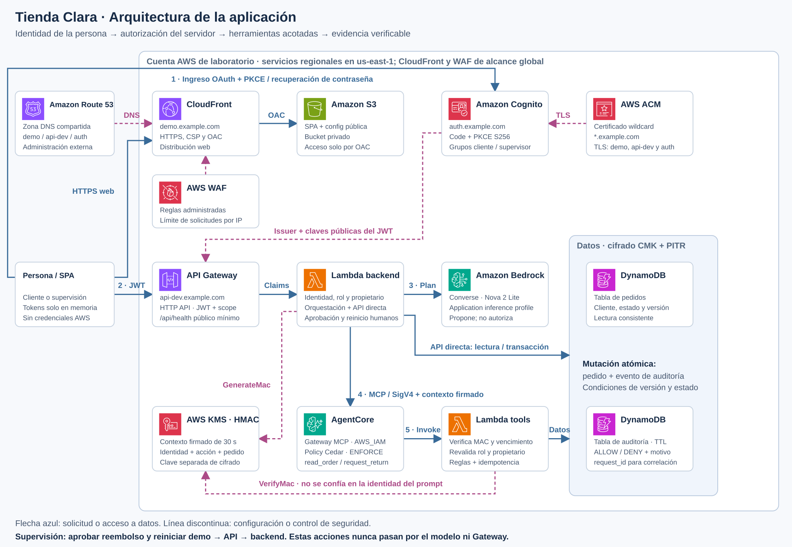
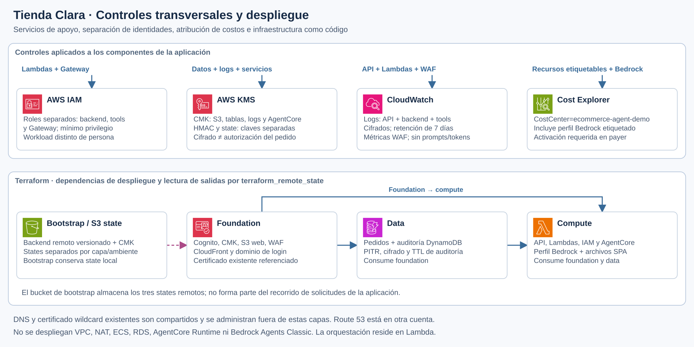

# Tienda Clara: identidad y acceso para agentes en AWS

Demo de un asistente de soporte posventa para la charla **«¿Quién le dio permisos a tu IA?»**, de Danny Friz, Arquitecto Cloud de Seguridad en SII Group, docente Duoc UC y mentor.

El cliente consulta un pedido propio y solicita una devolución. El agente interpreta la solicitud y propone herramientas; el backend verifica identidad, propiedad y reglas de negocio. Una persona con rol supervisor autoriza el reembolso desde un flujo independiente del chat. No se mueven fondos.

La política ficticia del laboratorio permite solicitar revisión hasta 90 días calendario desde la compra, inclusive. Desde el día 91 el servidor rechaza nuevas devoluciones y aprobaciones, aunque la persona tenga el perfil correcto. Diego puede comparar P-205, con 30 días al preparar los datos, y P-206, con 120 días. Consultar P-206 sigue permitido; la solicitud de devolución muestra `REFUND_WINDOW_EXPIRED`. Reiniciar el pedido conserva su fecha de compra.

[Presentación: identidad y acceso para agentes en AWS](docs/presentaciones/Danny_Friz_SCD_2026_arquitectura_IA.pptx), con 22 diapositivas principales, tres pausas para demostrar permisos y ocho anexos técnicos. El recorrido conecta identidad humana y de la aplicación, IAM, AgentCore, autorización externa al modelo y evidencia. Ver el [guion de 35 minutos más preguntas](docs/demo-35-minutos.md) y la [alineación con la charla](docs/foco-charla.md).

La oratoria mantiene un tono natural para estudiantes de nivel 200 con nociones básicas de IAM. Las notas contienen solo el discurso. El [texto fuente](docs/presentaciones/oratoria-nivel-200.json) sincroniza la PPT y el guion separado, donde quedan los tiempos, las instrucciones de demo y las referencias.

La demo principal compara la consulta de Camila a P-104 con el rechazo de P-205 y comprueba que escribir «soy gerente» no cambia sus permisos. El cierre ofrece criterios para asignar responsables, revisar permisos y retirar accesos. La arquitectura completa y el detalle del reembolso quedan disponibles como apoyo para preguntas.

Los [nombres y ARN de referencia](docs/recursos-demo.md) conectan los diagramas con las Lambdas y tablas verificadas en AWS, usando `CUENTA_AWS` como marcador de la cuenta.

## Estado y alcance

Este repositorio entrega código e infraestructura declarativa para desplegar una demo en una cuenta AWS de laboratorio. **Descargarlo no despliega recursos AWS.** Los datos son ficticios. No constituye una plataforma productiva de comercio, pagos o cumplimiento normativo.

La implementación integra **Amazon Bedrock Converse**, Amazon Cognito, API Gateway, AWS Lambda, Amazon DynamoDB, Amazon S3 y Amazon CloudFront. Con `enable_agentcore=true`, valor predeterminado, las herramientas propuestas en el chat pasan por **Amazon Bedrock AgentCore Gateway y Policy en modo ENFORCE**. El contexto confiable se firma con KMS HMAC y el target comprueba identidad, propiedad y reglas de negocio. No se usa AgentCore Runtime ni Bedrock Agents Classic. El recorrido se validó en la cuenta de laboratorio; la evidencia y las limitaciones están en [despliegue de la demo](docs/operacion.md). Consulta [Arquitectura](docs/arquitectura.md).

## Arquitectura

Las capacidades opcionales agregan **AgentCore Memory** para referencias de pedidos durante 15 minutos y preferencias explícitas entre sesiones, **Bedrock Knowledge Bases** con políticas ficticias en S3 Vectors y **Bedrock Guardrails** para filtrar contenido. Las aclaraciones son respuestas válidas: «Quiero devolver un pedido» → «¿Cuál?» → «P-104». La memoria no conserva permisos ni reemplaza el estado de DynamoDB. Ver [memoria y conocimiento](docs/memoria-y-conocimiento.md) y [evaluaciones del agente](docs/evaluaciones-agente.md).

[](docs/assets/arquitectura-aplicacion.svg)

[Abrir diagrama de aplicación en tamaño completo](docs/assets/arquitectura-aplicacion.svg).

| Recorrido | Relaciones y controles |
|---|---|
| Entrega web | Route 53 resuelve `demo` hacia CloudFront; WAF protege esa distribución. CloudFront obtiene la SPA de S3 privado mediante OAC. |
| Ingreso | La SPA inicia Authorization Code + PKCE S256 en Cognito (`auth`). El access token queda en memoria y se envía a API Gateway (`api-dev`). |
| API | El authorizer valida JWT y scope. Lambda backend deriva identidad y rol de los claims y verifica el propietario del pedido. `/api/health` entrega solamente estado público mínimo. |
| Chat y modelo | El backend invoca Bedrock Converse mediante un application inference profile. El modelo propone una herramienta; no decide permisos. |
| Contexto y preferencias | El backend carga contexto mínimo de AgentCore Memory usando la identidad validada y la conversación. Otra memoria guarda solo idioma y detalle elegidos por la persona. |
| Políticas y contenido | Guardrails evalúa el mensaje. Las preguntas generales pueden buscar extractos de políticas en Knowledge Bases, con Titan Text Embeddings V2 y S3 Vectors; se muestran fuentes y se filtra la respuesta. Esta ruta no consulta pedidos. |
| Herramientas | El backend firma contexto de 30 segundos con KMS HMAC y llama AgentCore Gateway con MCP + SigV4. Policy Cedar en ENFORCE permite solo `read_order` y `request_return`; la Lambda target verifica el MAC y vuelve a comprobar rol, propietario y reglas. |
| Datos y evidencia | Ambas Lambdas acceden a pedidos y auditoría en DynamoDB. Los cambios usan una transacción atómica de pedido + evento, con condiciones de versión y estado. Las tablas tienen CMK y PITR; la auditoría tiene TTL. |
| Decisión humana | Aprobar un reembolso y reiniciar el pedido demo requieren supervisión, confirmación explícita y versión vigente. Pasan por API y backend; no se ofrecen al modelo ni a Gateway. |

[](docs/assets/arquitectura-operacion.svg)

[Abrir diagrama de controles y despliegue en tamaño completo](docs/assets/arquitectura-operacion.svg).

IAM separa los roles del backend, las herramientas y Gateway. CloudWatch recibe logs cifrados de API y Lambdas; WAF publica métricas. `CostCenter=ecommerce-agent-demo` permite atribuir consumo de recursos etiquetables y del perfil Bedrock; requiere activar los tags en Billing de la cuenta administradora. El [reporte diario](docs/costos.md) documenta los límites de atribución.

Terraform crea primero el backend S3 versionado y cifrado en `bootstrap`, y luego las capas `foundation` → `data` → `compute`. Las capas consumen las salidas de sus dependencias mediante `terraform_remote_state`. El DNS compartido y el certificado wildcard existente se administran fuera de estas capas; la distribución de `auth` la administra Cognito. WAF se asocia al frontend CloudFront; no se lo representa protegiendo la API ni Cognito.

Los diagramas representan el recorrido con `enable_agentcore=true`. Ver [arquitectura y límites de confianza](docs/arquitectura.md), [despliegue verificado](docs/operacion.md) y [fuente de los íconos y regeneración](docs/assets/README.md).

El frontend no contiene credenciales AWS. La identidad del usuario viene del JWT validado; la identidad de la carga de trabajo es el IAM execution role de Lambda, con credenciales temporales administradas por AWS. El modelo no autoriza operaciones.

## Estructura

| Carpeta | Responsabilidad |
|---|---|
| `src/` | Dominio, casos de uso, adaptadores y entrada Lambda |
| `tests/` | Pruebas de negocio, autorización y contratos |
| `web/` | SPA accesible sin framework, autenticación y aprobación humana |
| `infra/` | Terraform en capas `foundation` → `data` → `compute`, más bootstrap |
| `scripts/` | Flujos repetibles de validación, empaquetado, despliegue y demo |
| `docs/` | Arquitectura, seguridad, guía del expositor y operación |

## Requisitos

- Una cuenta AWS de laboratorio y un perfil AWS CLI con sesión vigente; preferir IAM Identity Center/SSO.
- Terraform **1.17.0** y AWS provider **6.70.0**, fijados en las herramientas/locks del proyecto.
- Python **3.14.9** como base compatible con el runtime Lambda `python3.14` generalmente disponible; CI también comprueba **3.15.1**, última versión estable del lenguaje. Dependencias fijadas en `requirements.lock`.
- Permiso y disponibilidad regional del modelo configurado para Bedrock. Verificar habilitación, cuotas y términos del proveedor del modelo.
- PowerShell **7.6.8** para los scripts incluidos. Node.js **26.12.1 Current** y npm **12.2.1** para las pruebas del frontend. Git for Windows **2.56.0.windows.3** y AWS CLI **2.38.5** como herramientas de operación.

Estas versiones estables se contrastaron con fuentes oficiales el **23 de octubre de 2026**. Python 3.15.1 es estable como lenguaje, pero su runtime Lambda sigue en preview: el despliegue conserva `python3.14`, última rama GA. Se eligió Node Current según el requisito de usar la última estable; no se lo presenta como LTS. CI utiliza `ubuntu-26.04`, ya disponible de forma general, y actions fijadas por SHA. Consultar [versiones y fuentes](docs/versiones.md) y [validación ejecutada](docs/validacion.md).

Al incorporar o actualizar herramientas y dependencias, verificar versiones contra sus fuentes oficiales. CI ejecuta este control cuando cambian los archivos de versiones, dependencias, instalación o workflows que contienen los pins. Falla si encuentra una nueva versión estable, un pin inconsistente o una fuente no verificable:

```powershell
& ".\scripts\Check-Versions.ps1"
```

`toolchain.versions.json` registra las versiones seleccionadas y su procedencia; `.build/version-audit.json` guarda la consulta actual. Actualizar los pins y hashes, revisar compatibilidad y repetir las pruebas antes de aceptar una actualización. No instalar `latest` sin fijar el resultado.

No usar el usuario root ni credenciales de larga duración en archivos del proyecto.

Para reutilizar un certificado existente y un dominio propio, consultar [dominio HTTPS de desarrollo](docs/dominio-desarrollo.md). Foundation entrega el destino DNS y comprueba que el ARN pertenezca a la cuenta esperada y a `us-east-1`.

## Preparación y despliegue

Antes de revisar el plan o publicar el código, ejecutar el [análisis con Trivy](docs/analisis-seguridad.md):

```powershell
& ".\scripts\Scan-Security.ps1"
```

CI exige el mismo análisis y bloquea HIGH/CRITICAL, incluidas vulnerabilidades sin corrección disponible. Las observaciones restantes se conservan en el reporte.

1. Leer [Operación](docs/operacion.md) y configurar las variables de ejemplo de Terraform con región, prefijo, perfil y modelo válidos para tu cuenta. Instalar las dependencias fijadas y verificadas por hashes antes de las pruebas:

```powershell
python -m pip install --require-hashes -r requirements.lock
```

Preparar el bootstrap con un archivo de variables local, excluido de Git, y revisar el plan:

```powershell
& ".\scripts\Init-State.ps1" -Profile TU_PERFIL -VarFile "C:\config\bootstrap.tfvars" -Action plan
```

Aplicar el bootstrap de forma deliberada con `-Action apply`. El script genera `.build/outputs/bootstrap.json` y `.build/backend/foundation.hcl`, `data.hcl` y `compute.hcl`. El bootstrap es separado porque el bucket de estado debe existir antes de inicializar las capas. Completar `state_bucket` y región de los archivos de variables de aplicación según esas salidas y los ejemplos de cada capa. No publicar archivos con identificadores de la cuenta o configuraciones privadas.
2. Ejecutar las pruebas afectadas por los cambios desde la raíz del repositorio:

```powershell
& ".\scripts\Test.ps1"
```

La selección usa los cambios locales y sus dependencias. Para revisar el plan sin ejecutar pruebas, usar `-PlanOnly`; para validar todo, usar `-Full`. En una copia recién clonada, sin modificaciones locales, usar `-Full` para la comprobación inicial. El [procedimiento de pruebas diferenciales](docs/pruebas-diferenciales.md) explica los criterios y la comparación entre commits.

Crear el paquete Lambda cuando cambien el backend o sus dependencias:

```powershell
& ".\scripts\Package.ps1"
```

3. Desplegar las capas en orden. Revisar el plan antes de cada aplicación:

```powershell
& ".\scripts\Deploy.ps1" -Layer foundation -Action plan -Profile TU_PERFIL -BackendConfig ".\.build\backend\foundation.hcl" -VarFile "C:\config\foundation.tfvars" -Environment demo
```

```powershell
& ".\scripts\Deploy.ps1" -Layer foundation -Action apply -Profile TU_PERFIL -BackendConfig ".\.build\backend\foundation.hcl" -VarFile "C:\config\foundation.tfvars" -Environment demo
```

Repetir con `data` y luego `compute`, usando los archivos de variables y backend correspondientes. Cada `apply` genera `.build/outputs/{capa}.json`; `plan` no genera outputs. Solo se admiten ambientes `demo`, `dev` y `test`; el script bloquea `apply` de producción. No omitir la revisión del plan ni copiar salidas sensibles a incidencias públicas.

4. Crear los usuarios de demostración y asociar sus identificadores Cognito a los pedidos ficticios:

```powershell
& ".\scripts\Seed-Demo.ps1" -Profile TU_PERFIL
```

El script usa por defecto `.build/outputs/foundation.json` y `.build/outputs/data.json`. `-FoundationOutputs` y `-DataOutputs` permiten rutas alternativas. Solicita las contraseñas de forma interactiva y no las recibe en argumentos ni las escribe en logs o archivos. Los usuarios son `camila`, `diego` y `sofia` (sin tilde para ingresar); la interfaz puede mostrar Sofía. El registro público está deshabilitado. Conservar cliente y supervisión separados; nunca usar un selector ficticio como autenticación AWS. `-ResetOrders` es una opción explícita para reiniciar únicamente los dos pedidos ficticios mediante condiciones de propietario y versión; no agregarla como paso rutinario sin revisar el estado.

5. Terraform en `compute` publica automáticamente `web/` y genera `config.js` con configuración pública real. `foundation` configura los callbacks y logout de Cognito según la URL del frontend. Abrir la URL HTTPS de CloudFront indicada en `.build/outputs/compute.json`; no se necesita publicar archivos manualmente.
6. Ejecutar el smoke test: comprueba HTTPS del frontend y que `/api/me` sin JWT rechace con 401/403. No recibe tokens ni modifica recursos AWS:

```powershell
& ".\scripts\Smoke-Test.ps1"
```

Para inspeccionar el frontend localmente:

```powershell
& ".\scripts\Serve-Web.ps1" -Port 8766
```

La vista local sirve `web/config.example.js` como `/config.js`, con endpoints ficticios; permite revisar la interfaz, sin demostrar autenticación ni llamadas AWS. Abrir `http://127.0.0.1:8766/`, que coincide con el callback del ejemplo. `web/config.js` es un archivo local opcional excluido de Git; no se publica el ejemplo como configuración AWS. Cualquier modo simulado debe identificarse como tal y no reutilizarse como autenticación del despliegue. No copiar tokens en parámetros de URL.

## Experiencia de la demo

- **Camila, cliente:** consulta P-104 y solicita su devolución; no accede al pedido de Diego.
- **Diego, cliente:** tiene otro pedido y los mismos límites de propiedad.
- **Sofía, supervisión:** abre pedidos desde la bandeja de solicitudes pendientes, que se actualiza automáticamente, y autoriza un reembolso con confirmación explícita y control de versión.
- El texto «soy gerente» no cambia claims ni permisos. El modelo no puede aprobar un reembolso, ni siquiera cuando conversa con una persona supervisora.

La auditoría permite contrastar acciones permitidas, bloqueadas y ejecutadas. Las respuestas incluyen `request_id` para correlación. Evitar capturas con tokens o datos reales.

## Calidad y seguridad

La autorización vive fuera del modelo y se prueba con operaciones directas a la API. La separación dominio/aplicación/adaptadores permite probar políticas sin AWS. Las mutaciones usan condiciones de DynamoDB para evitar aprobar una versión desactualizada o repetir efectos. [Decisiones de diseño](docs/decisiones.md) explica cómo se aplican KISS, DRY, SOLID y arquitectura limpia sin añadir capas por decoración.

Consulta [Contrato de API](docs/api.md), [Modelo de amenazas](docs/seguridad.md), [SECURITY.md](SECURITY.md), [Contribución](CONTRIBUTING.md) y el [guion de 35 minutos](docs/demo-35-minutos.md).

## Costos y retiro

Bedrock, Lambda, API Gateway, DynamoDB, CloudFront, S3, KMS y logs pueden generar costos. No se garantiza costo cero. Revisar los precios de la región, presupuestos, retención y cuotas antes del evento. El retiro es manual, con revisión de dependencias y datos; consulta [Operación](docs/operacion.md). Nunca borrar automáticamente recursos o evidencia al terminar una demo.

## Publicación

Repositorio público para compartir en la charla: [dannyfriz/aws-ecommerce-agent-demo](https://github.com/dannyfriz/aws-ecommerce-agent-demo). Contiene una copia seleccionada con historial nuevo, ejemplos genéricos y la presentación final. El repositorio de trabajo conserva su visibilidad privada. Ver [alcance de la publicación](docs/operacion.md).

La publicación excluye estados Terraform, planes, archivos de variables privadas, tokens y credenciales. Antes de cada contribución, revisar los archivos preparados para commit y ejecutar las verificaciones de seguridad. El titular todavía no ha definido una licencia de distribución; la visibilidad pública no concede por sí sola una licencia de código abierto.
