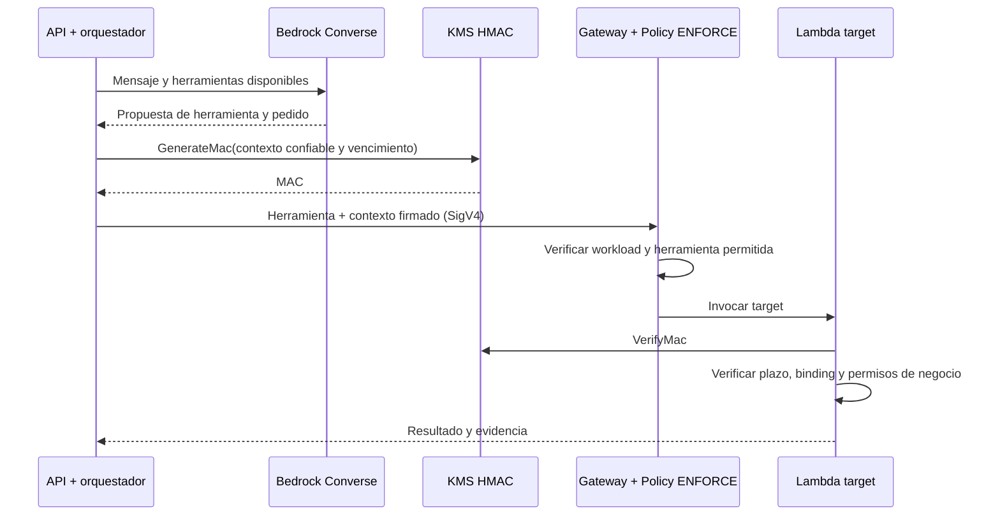

# Arquitectura y límites de confianza

## Ruta principal

1. CloudFront sirve una SPA desde S3 privado mediante Origin Access Control. El navegador recibe únicamente configuración pública de endpoints y client ID.
2. Cognito autentica con Authorization Code y PKCE S256, sin client secret en la SPA. El registro de usuarios lo administra el laboratorio.
3. API Gateway valida el JWT, issuer, audience/client ID y scope configurado antes de invocar Lambda. El backend deriva identidad y grupos desde los claims validados del authorizer; nunca desde el mensaje, `role`, `customer_id` o cabeceras inventadas por el cliente.
4. La aplicación interpreta mensajes mediante Bedrock Converse. La salida del modelo es una propuesta no confiable de herramientas con argumentos limitados.
5. Con `enable_agentcore=true`, el orquestador envía las herramientas propuestas por el chat a AgentCore Gateway autenticándose como workload con AWS_IAM. Antes firma un contexto con KMS HMAC, usando identidad validada, acción, pedido y vencimiento breve. Policy en modo ENFORCE permite únicamente las herramientas habilitadas al rol del backend.
6. La Lambda target verifica el MAC, vencimiento y enlace entre contexto, acción y pedido. Después el caso de uso comprueba ownership, rol y estado de negocio. Ni los argumentos del modelo ni los parámetros del navegador asignan identidad. Acciones desconocidas o no permitidas fallan de manera cerrada.
7. DynamoDB persiste pedidos y evidencia. Las actualizaciones condicionadas comprueban versión y estado; una repetición no duplica efectos.
8. Las consultas y herramientas directas de la API ejecutan los controles del backend normal. La aprobación de reembolso también ocurre en ese backend, mediante endpoint y pantalla separados, con supervisor autenticado, pedido actualizado, confirmación y `expected_version`. Gateway no expone una herramienta de aprobación y el chat no puede aprobar.

## Dos identidades

| Identidad | Fuente de confianza | Qué controla |
|---|---|---|
| Persona | Cognito + authorizer JWT | Propiedad del pedido, rol y posibilidad de aprobar |
| Carga de trabajo | IAM execution role de Lambda | Acceso a tablas específicas, logs, clave y modelo |

IAM no reemplaza la autorización de negocio: permitir `dynamodb:GetItem` sobre una tabla no determina cuál pedido corresponde al cliente. La política IAM de Gateway limita el workload que llama y las dos herramientas que puede invocar; no autoriza por sí sola a la persona. El target conserva ownership y reglas de negocio. A su vez, una aprobación humana no reemplaza IAM ni las validaciones del backend.

## Frontend y sesión

`web/auth.js` valida URLs de configuración y coincidencia del callback, crea `state` y `code_verifier` aleatorios, guarda únicamente la transacción pendiente en `sessionStorage` y la hace vencer en diez minutos. Después de verificar el estado, elimina los parámetros OAuth del historial y canjea el código con PKCE. Los tokens quedan solo en memoria: recargar exige un nuevo flujo de ingreso, aunque Cognito pueda conservar su propia sesión. El logout elimina la sesión local y dirige a Cognito.

No se cargan scripts de terceros. El contenido de usuario, modelo y API se presenta con `textContent`/nodos de texto; no se interpreta como HTML. La SPA no usa claves AWS. El access token se envía únicamente al origen HTTPS de la API configurada. Esta decisión reduce persistencia de tokens, pero no elimina el riesgo de XSS: conservar CSP y revisión de dependencias y código.

## Capas Terraform

- `bootstrap`: backend S3 separado, cifrado y versionado para almacenar estado; acceso restringido.
- `foundation`: recursos compartidos de identidad y cifrado.
- `data`: tablas y almacenamiento; consume salidas de `foundation` por `terraform_remote_state`.
- `compute`: roles, Lambda, API y entrega web; consume salidas de capas previas.

Los state contienen información sensible y no se publican. `terraform_remote_state` requiere acceso al objeto de estado completo: limitar quién ejecuta Terraform y separar permisos del despliegue de los de la aplicación.

## AgentCore Gateway y contexto firmado

La orquestación sigue en Lambda y usa Bedrock Converse; **no se despliega AgentCore Runtime ni se usan Bedrock Agents Classic**. Terraform configura Gateway con AWS_IAM, una Lambda target y Policy en modo ENFORCE. Su superficie de herramientas es `read_order` y `request_return`, publicadas como `EcommerceTools___read_order` y `EcommerceTools___request_return` por el target `EcommerceTools`. El rol backend es el workload autorizado para llamar; el rol Gateway puede invocar la Lambda target.

El adaptador usa el contrato MCP stateless `2026-07-28`, sin handshake `initialize` ni puente de sesión. El recorrido limita la propuesta del modelo a una herramienta por mensaje para mantener una decisión observable y una evidencia fácil de seguir durante el evento. Esa simplificación no otorga nuevos permisos al modelo.

Gateway no propaga automáticamente la identidad humana a la herramienta. Después de recibir la propuesta del modelo, el orquestador crea un envelope `context: {payload, mac}`. Su payload contiene exactamente `sub`, `role`, `action`, `order_id`, `request_id`, `expires_at` y `nonce`, con identidad derivada de claims confiables y vencimiento máximo de 30 segundos. Firma el contexto mediante `kms:GenerateMac` con HMAC_SHA_256. Este contexto no forma parte del prompt ni lo produce el modelo.

El target usa `kms:VerifyMac` y rechaza contexto alterado, vencido, con plazo excesivo, herramienta distinta o pedido diferente. Solo el orquestador puede generar MAC; solo el target verifica. La clave HMAC es distinta de las CMK de cifrado. Los reintentos siguen sujetos a idempotencia y controles de estado; una firma no sustituye esos controles ni convierte el contexto en un token de autorización general.

`enable_agentcore=false` permite el camino directo del adaptador de herramientas para pruebas o diagnóstico; no se debe presentar ese modo como protegido por Gateway. `LOG_ONLY` solo registra: la configuración destinada a demostrar bloqueo usa ENFORCE. El código y el plan declarativo requieren validación de extremo a extremo en la cuenta y región elegidas antes de afirmar funcionamiento real. Ver [ADR del contexto firmado](adr-001-contexto-hmac.md).

## Fuera del alcance

Pagos, datos reales, catálogo comercial, antifraude, recuperación ante desastre productiva, gestión completa de sesiones revocadas y disponibilidad garantizada. CloudFront no vuelve privada la interfaz pública; la API y los datos se protegen con autorización independiente.
